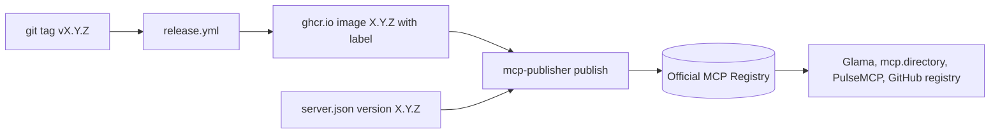

# MCP registry listing

The sidecar is listed in the official MCP Registry as `dev.xakpc/sqlite-mcp-sidecar`. Other
MCP directories (Glama, mcp.directory, PulseMCP, the GitHub MCP Registry) import from the official
registry, thus this one entry is the source for most listings.

Code: `server.json` at the repository root, and one `LABEL` in
`src/Xakpc.SQLiteMCPSidecar/Dockerfile`.



## Ownership proof

The registry proves that the publisher owns an OCI package with an image label. The value must be
equal to `name` in `server.json`:

```dockerfile
LABEL io.modelcontextprotocol.server.name="dev.xakpc/sqlite-mcp-sidecar"
```

The `dev.xakpc/` namespace is the reverse DNS of the owner's domain `xakpc.dev`. The proof is DNS: a
TXT record on the apex `xakpc.dev` holds the ed25519 public key. The private key is only on the
owner's machine (`~/.config/mcp-publisher/xakpc-dev-ed25519.pem`). It is not in a repository. Thus a
publish needs no browser login:

```bash
KEY=$(openssl pkey -in ~/.config/mcp-publisher/xakpc-dev-ed25519.pem -outform DER | tail -c 32 | xxd -p -c 64)
mcp-publisher validate
mcp-publisher login dns --domain xakpc.dev --private-key "$KEY"
mcp-publisher publish
```

The TXT record:

```text
xakpc.dev  TXT  "v=MCPv1; k=ed25519; p=GNYepfGZefP8LGTRdRC8hPyVtFyqny8DbR/5lt/Ke7g="
```

A domain namespace does not depend on the GitHub account or the repository name. If the key is lost,
make a new pair and replace the TXT record.

## The package entry

One `oci` package with the transport `streamable-http`. The sidecar is an HTTP server and not a
stdio process, thus the entry gives the URL that the client calls after it starts the container:

```json
"transport": {
  "type": "streamable-http",
  "url": "http://localhost:8080/db/mcp",
  "headers": [{ "name": "Authorization", "value": "Bearer {token}", "isSecret": true }]
}
```

The `runtimeArguments` repeat the hardened `docker run` of `README.md`: loopback port, a writable
`/data` mount, `--read-only`, `--tmpfs /tmp`, `--cap-drop ALL`. The `environmentVariables` name the
two mandatory values and the permission set with its read-only default.

## Invariants

- `version` in `server.json`, the tag in `identifier`, and the git tag are the same value. A version
  in the registry is immutable, thus each release needs a new `server.json` version.
- Publish only after `release.yml` pushed the image. The registry reads the label from the tag in
  `identifier`; an image that does not exist yet fails the check.
- `description` is at most 100 characters.
- `mcp-publisher validate` checks the file before a publish.

## Lessons

- An image from before the label (`0.1.0`, `0.1.1`) cannot be listed. `0.1.2` carries the label with
  the old name `io.github.xakpc/sqlite-mcp-sidecar` and was never published. The first listed
  version is `0.1.3`.
- The label value is part of the image. A change of the registry name needs a new release.

## Related

- [distribution.md](distribution.md): how a tag becomes an image
- [container.md](container.md): the Dockerfile
